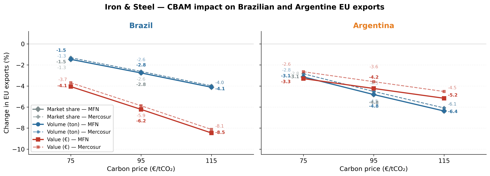
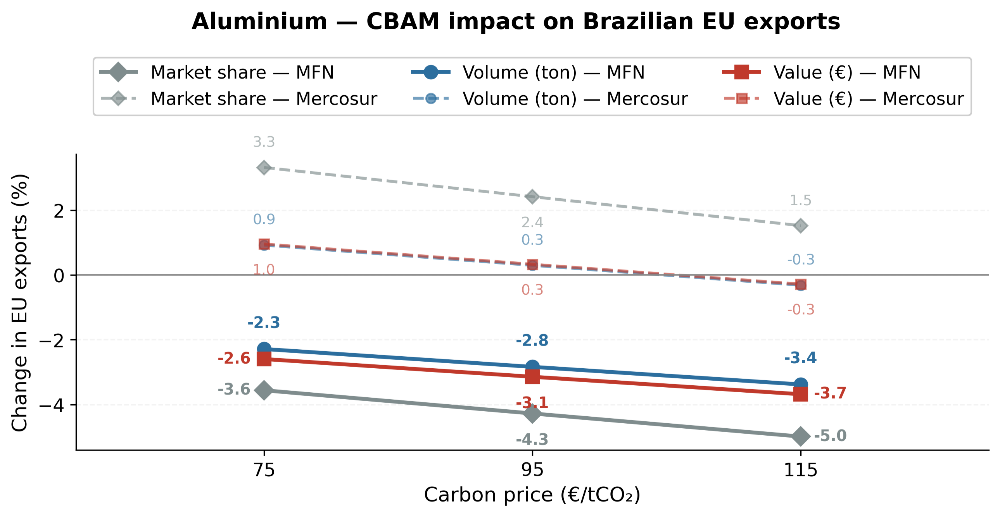
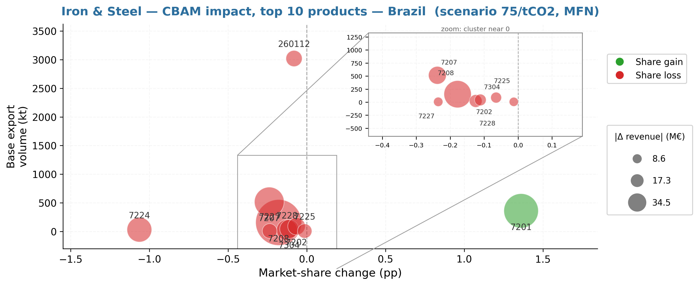

# CBAM-Trade-Impact-Model

**CBAM and Export Competitiveness: Market Share Elasticity Estimates and Simulations for Brazil and Argentina**

Lorenzo Viana Lima and Flávio Tosi Feijó. The paper is in `paper/`.

Replication files for a paper on how the EU's Carbon Border Adjustment
Mechanism (CBAM) affects the competitiveness of Brazilian and Argentine
exports in **iron & steel, aluminium and cement**. A structural gravity model
estimated by PPML with fixed effects gives market-share price elasticities at
the individual product level (trade flows from more than 150 countries to the
EU, 2010 to 2025). These elasticities feed CBAM cost simulations under three
carbon prices and two tariff regimes (MFN and Mercosul).

## Main findings

- Impacts are negative but moderate, and highly heterogeneous across products.
- In iron & steel, Brazil's exposure is concentrated in higher value-added
  products. For Argentina, lower substitution elasticities soften the impact.
- In aluminium, eliminating the tariff under the Mercosul-EU agreement offsets
  the CBAM cost at the lower carbon prices.
- Product-level disaggregation is decisive: sector-level analyses hide the
  heterogeneity that determines the competitive impact on each country.







## Method

- **Estimator:** PPML (`fixest::fepois`) on market share, with
  `exporter x product` and `product x year` fixed effects.
- **Price variable:** post-tariff unit price relative to the leave-one-out
  average price of competitors.
- **Country elasticities:** shrunk towards the sector-wide elasticity. The v2
  model adds a sign constraint: a country estimate with the wrong (positive)
  sign is censored at zero before shrinkage.
- **Simulation:** CBAM cost = product-level emission factor x carbon price is
  added to the price of each non-exempt exporter. Shares of all exporters are
  renormalised to sum to one. EU/EEA/Switzerland are exempt.
- **Scenarios:** carbon price of EUR 75, 95 and 115 per tCO2, under MFN and
  Mercosul tariffs (6 per sector).
- **Validation:** out-of-sample test (train to 2022, test 2025), explained
  variation split between fixed effects and price, and a historical test with
  the 2016 EU anti-dumping duties on cold-rolled steel.

## Repository layout

```
paper/          the paper (PDF)
main_v2.R       official model; configuration at the top
rodar_modelo.R  runner: set PRODUTO / PAISES / NOME and run
scripts/        pipeline 00 to 09 (+ 04b), sourced in order by main_v2.R
helpers/        shrinkage with sign constraint, goodness of fit, beta audit
config/         trade data, emission factors, product-to-group mappings
figuras/        Python scripts for the paper figures
analysis/       extra analysis: pure reallocation vs. green technology
images/         figures shown in this README
outputs/        model results per run (generated, git-ignored)
```

### scripts and helpers

- `00_tracking.R`: sample tracking after each filter.
- `01_limpeza.R`: cleaning, prices, leave-one-out relative price, market share.
- `02_modelo.R`: PPML estimation.
- `03_paises.R`: country-specific elasticities with shrinkage.
- `04_validacao.R`, `04b_validacao_delta.R`: out-of-sample validation (levels and changes).
- `05_grupos.R`: elasticities by processing stage (uses `config/*_grupos.R`).
- `06_robustez_paises.R`: robustness against a basket-restricted model.
- `07_simulacao_cbam.R`: 6 scenarios with competitive renormalisation of shares.
- `08_projecao_cbam.R`: cumulative projection 2026 to 2028.
- `09_analise.R`: impact tables, charts, emissions, goodness of fit.
- `helpers/funcoes_modelo_v2.R`: shrinkage with the sign constraint.

### config

- `Base_de_dados_final_{Ferro,Aluminio,Cimento}.csv`: bilateral trade data (volume, value, price, tariff) by exporter and HS product.
- `Base_fatores_*_ajustada.csv`: emission factors by exporter and product, with the CBAM phase-in factors for 2026 to 2028. Non-EU exporters plus a rest-of-world fallback.
- `*_grupos.R`: product-to-group mappings.

### figuras (paper figures)

| Figure | Script |
|---|---|
| 1. R² decomposition (share changes) | `_r2_decomp_delta.py` |
| 2 and 3. Elasticities, Brazil and Argentina | `_graficos_secao1_paises_v2.py` |
| 4. Impact scenarios, iron & steel | `_graf_sim_FA_resumo_v3.py` |
| 5 and 10. Impact by product, Brazil and Argentina | `_graf_bubble_separado.py` |
| 6. Impact scenarios, aluminium | `_graf_sim_AL_resumo_v2.py` |
| 8 and 9. Historical validation (anti-dumping 2016) | `_teste_antidumping_2016.py`, `_teste_antidumping_2016_opA.py` |
| 11. Tariffs vs. CBAM cost, aluminium | `_graf_AL_tarifa_vs_cbam.py` |
| Table 4. Explanatory power | `_graficos_secao1.py` |

The histogram of relative prices (Figure 7) and the panel-diagnostic and
robustness tables (Tables 2, 3, 5 and 6) are not generated by scripts in this
repository.

### analysis

`analysis/analise_realocacao_verde.R` holds emission factors fixed across
scenarios, so every change in volume or embedded emissions is pure
reallocation of the supplier basket, with no technological response by
exporters. It reports the aggregate change in embedded emissions, the average
carbon intensity of the basket before and after, and whether dirtier exporters
lose more share. This analysis is not part of the paper; its outputs are the
two CSV files in the same folder. It reads model runs named `cesta_padrao`
(set `NOME` in `rodar_modelo.R`). Caveat: the emission-factor file has no EU
producers, so the effect on global emissions cannot be assessed.

## How to replicate

1. Install R 4.5 with `tidyverse`, `fixest`, `broom`, `ggplot2` and `janitor`,
   and Python 3 with `matplotlib` for the figures.
2. Edit the three lines at the top of `rodar_modelo.R`:

   ```r
   PRODUTO <- "ferro_aco"          # "ferro_aco" | "aluminio" | "cimento"
   PAISES  <- c("BR", "AR")        # focal countries (ISO-2)
   NOME    <- "brazil_and_argentina"
   ```

3. From the repository root run `Rscript rodar_modelo.R`. Results go to
   `outputs/<product>_<name>_individual_post_tax_j3_v2/`.
4. Build a figure with, for example, `python figuras/_graf_sim_FA_resumo_v3.py`.
   The scripts read from `outputs/` and write to `figuras_geradas/`; run them
   from the repository root, after the model runs they depend on.

`outputs/` and `figuras_geradas/` are regenerated by the code and are
git-ignored.

Language: documentation, code comments, console messages and chart text are in
English. File names, CSV column names and variable names keep their original
Portuguese identifiers (for example `cenario_carbono`,
`13_cbam_resumo_pais.csv`).

## Data

Trade data and emission factors in `config/` are the inputs used in the paper.
Check the terms of the original sources before reusing them.

## License

Code is released under the MIT License (see `LICENSE`). The paper in `paper/`
is not covered by that license.
